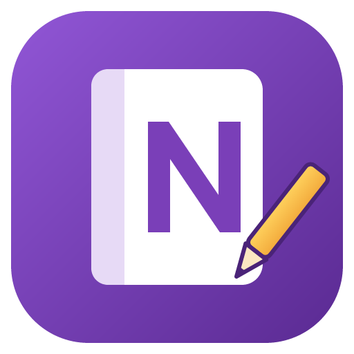
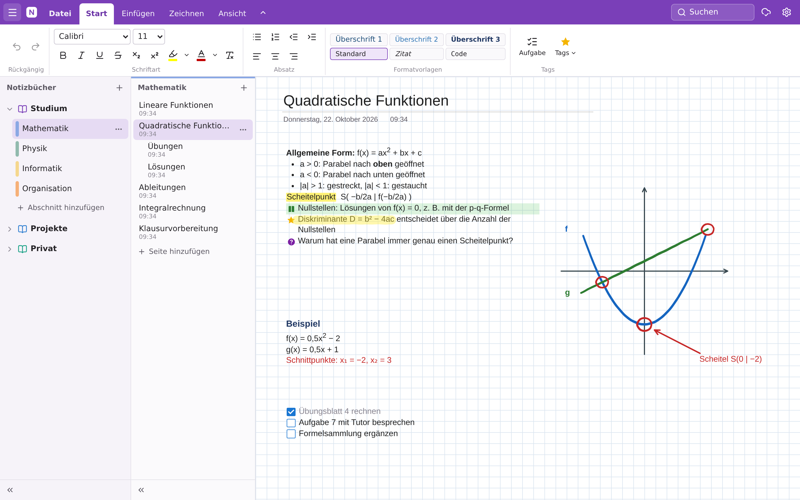
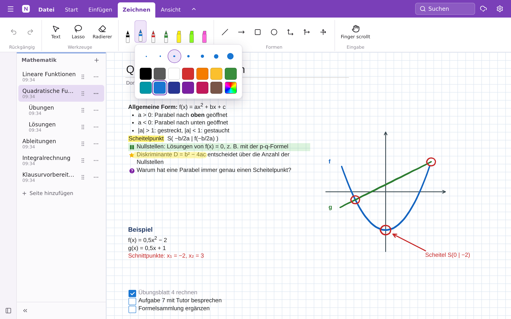
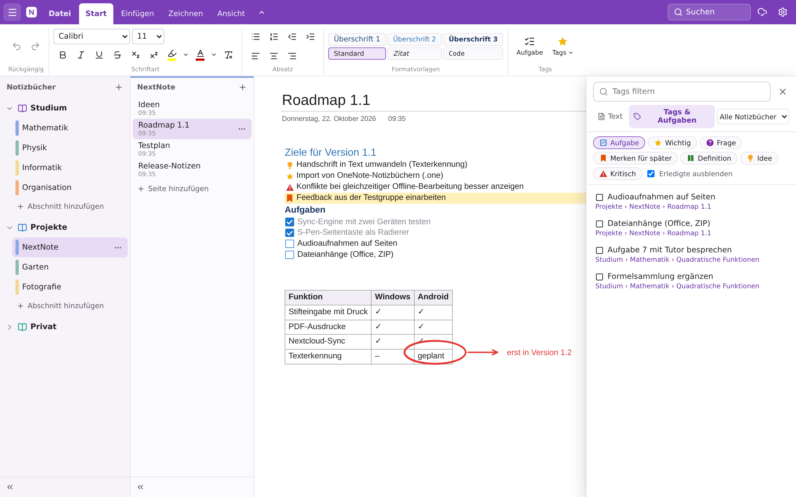
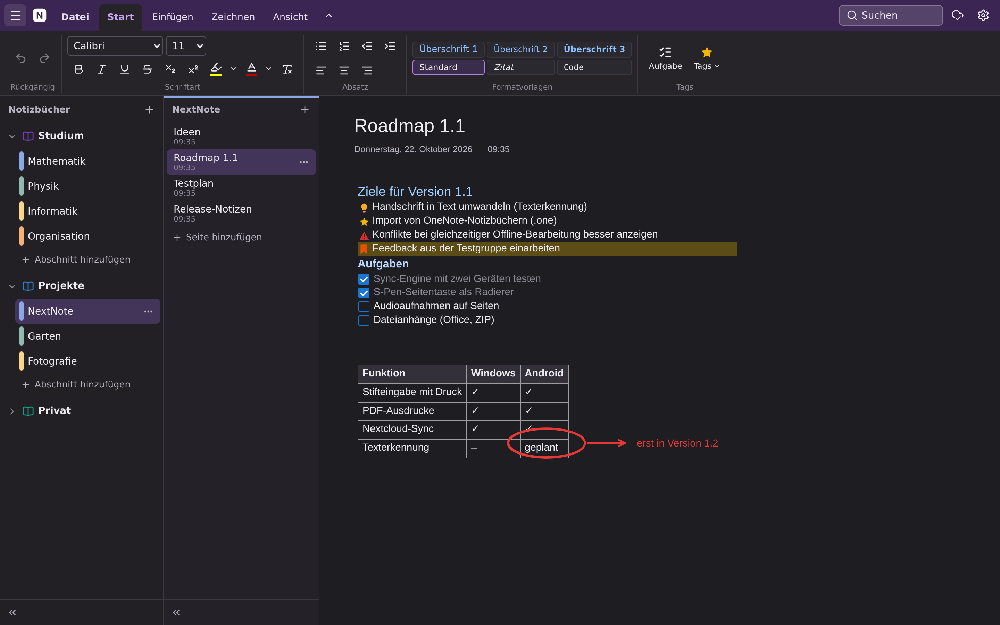

<p align="center">
  
</p>

<h1 align="center">NextNote</h1>

<p align="center">
  <b>Notizbücher wie in OneNote, gespeichert in deiner eigenen Nextcloud.</b><br>
  Für Windows und Android, gebaut für Tablets mit Stift (z. B. Galaxy Tab mit S Pen).
</p>

<p align="center">
  <a href="LICENSE"></a>
  
  
</p>

<p align="center">
  
</p>

> **English:** NextNote is a OneNote-style note-taking app for Windows and Android with pen input. Notebooks are stored as plain JSON files in your own Nextcloud and synced between devices. The user interface is currently German only.

## Warum NextNote?

- **Deine Daten, dein Server.** Die Notizen liegen als lesbare Dateien in einem Ordner deiner Nextcloud. Ein Microsoft-Konto oder eine fremde Cloud brauchst du nicht.
- **Freie Seite wie in OneNote.** Text, Handschrift, Bilder und PDFs stehen dort auf der Seite, wo du sie hinsetzt.
- **Stift ist kein Nachgedanke.** Druckstufen, Handballenerkennung, die S-Pen-Seitentaste als Radierer und Lasso-Auswahl.
- **Offline zuerst.** Alles wird lokal gespeichert und synchronisiert, sobald eine Verbindung besteht. Gleichzeitige Änderungen auf mehreren Geräten werden pro Element zusammengeführt.

## Funktionen

**Organisation**
- Notizbücher → farbige Abschnitte → Seiten mit bis zu zwei Ebenen Unterseiten
- Verschieben per Drag & Drop oder Kontextmenü, auch zwischen Notizbüchern
- Suche über alle Notizbücher mit Hervorhebung auf der Seite
- Übersicht aller Tags und offenen Aufgaben über alle Notizbücher hinweg
- Papierkorb (60 Tage), Rückgängig/Wiederholen
- Seitenleisten lassen sich einklappen, damit die Seite den ganzen Bildschirm bekommt

**Seiten und Text**
- Textcontainer überall auf die Seite klicken, verschieben, Breite ändern
- Formatierung wie in OneNote: Schriftart und -größe, fett/kursiv/unterstrichen, Farben, Hervorheben, Listen, Einzüge, Ausrichtung, Überschriften, Zitat, Code, Tabellen, Links, Datum und Uhrzeit
- Tags: Aufgabe, Wichtig, Frage, Merken für später, Definition, Idee, Kritisch (Strg+1 bis Strg+7)
- Bilder aus Datei, Kamera, Zwischenablage oder per Drag & Drop
- **PDF-Ausdrucke**: Jede PDF-Seite wird als Bild eingefügt und lässt sich mit dem Stift beschriften
- Seitenhintergrund: Farbe, Linien, Karos oder Punkte
- Hell- und Dunkelmodus

**Stift**
- 4 Stifte und 3 Textmarker mit frei wählbarer Farbe und Stärke
- Radierer für ganze Striche oder punktgenau
- Lasso: verschieben, skalieren, Farbe ändern, duplizieren, kopieren
- Formen: Linie, Pfeil, Rechteck, Ellipse und drei Koordinatensysteme
- S Pen: zeichnet immer, auch im Textmodus; kurzes Tippen setzt den Cursor; **Seitentaste = Radierer**; der Finger scrollt und zoomt

**Synchronisierung**
- Anmeldung über den Nextcloud Login Flow: NextNote bekommt ein eigenes App-Passwort, das du in Nextcloud jederzeit widerrufen kannst
- Jede Seite ist eine eigene Datei. Änderungen an verschiedenen Elementen derselben Seite (z. B. Stift am Tablet, Text am PC) werden automatisch zusammengeführt
- Wurde derselbe Textcontainer auf zwei Geräten offline geändert, bleiben beide Fassungen erhalten (Konfliktkopie mit *Behalten*/*Verwerfen*)

## Screenshots

<table>
  <tr>
    <td width="50%"></td>
    <td width="50%"></td>
  </tr>
  <tr>
    <td align="center">Am Tablet: Stift-Menü mit Stärken, Farben und eigener Farbe</td>
    <td align="center">Alle offenen Aufgaben und Tags auf einen Blick</td>
  </tr>
  <tr>
    <td colspan="2"></td>
  </tr>
  <tr>
    <td colspan="2" align="center">Dunkelmodus</td>
  </tr>
</table>

## Installation

Fertige Dateien gibt es unter [**Releases**](https://github.com/grunch2001/NextNote/releases).

### Windows

`NextNote-Setup-<version>.exe` ausführen. Ohne Installation geht es mit `NextNote-<version>-portable.exe`.

Das Installationsprogramm ist nicht code-signiert. Windows SmartScreen meldet deshalb eventuell „Der Computer wurde durch Windows geschützt“. Weiter geht es über **Weitere Informationen → Trotzdem ausführen**.

### Android

1. `NextNote-<version>.apk` auf das Gerät laden (z. B. über die Nextcloud-App oder per USB).
2. Die APK antippen. Beim ersten Mal fragt Android, ob die App, mit der du sie öffnest, **unbekannte Apps installieren** darf. Das musst du erlauben.
3. Falls Google Play Protect warnt: „Trotzdem installieren“.

Updates installierst du genauso; deine Notizen bleiben dabei erhalten.

Voraussetzung: Android 7.0 oder neuer. Optimiert und getestet ist die App auf einem Samsung Galaxy Tab S10 Lite mit S Pen.

## Erste Schritte

1. NextNote starten und die Adresse deiner Nextcloud eingeben (z. B. `https://cloud.example.de`) → **Mit Nextcloud verbinden**.
2. Im Browser bei Nextcloud anmelden und **Zugriff gewähren**.
3. Fertig. Auf jedem weiteren Gerät meldest du dich genauso an.

Alternativ kannst du im Reiter **App-Passwort** Benutzernamen und ein in Nextcloud erzeugtes App-Passwort eingeben. Wer erst einmal ausprobieren will, startet ohne Nextcloud und verbindet sich später in den Einstellungen.

## Bedienung

| Aktion | So geht's |
| --- | --- |
| Text schreiben | Auf eine freie Stelle der Seite tippen und lostippen |
| Container verschieben / Breite ändern | Leiste über dem Text ziehen / rechten Rand ziehen |
| Handschrift | S Pen aufsetzen (Einstellung „Stift zeichnet immer“) oder im Reiter **Zeichnen** einen Stift wählen. Nochmal auf den aktiven Stift tippen öffnet Farbe und Stärke |
| Radieren | S-Pen-Seitentaste gedrückt halten oder Werkzeug **Radierer** (nochmal tippen → Modus und Größe) |
| Auswählen | **Lasso** im Reiter Zeichnen, oder mit der Maus ein Rechteck aufziehen. Auswahl ziehen = verschieben, runder Griff = skalieren |
| Scrollen / Zoomen | Finger ziehen / zwei Finger spreizen; am PC Mausrad und Strg+Mausrad |
| Kopieren & Einfügen | Auswahl → **Kopieren** in der Leiste über der Auswahl. Einfügen am Tablet: lange auf eine freie Stelle drücken → **Einfügen**; am PC Rechtsklick oder Strg+V. Text und Bilder aus anderen Apps funktionieren auch |
| PDF beschriften | **Einfügen → PDF-Ausdruck** oder PDF auf die Seite ziehen |
| Seite/Abschnitt verschieben | Ziehen (am Tablet am Griff ⠿) oder Kontextmenü „…“ → *Verschieben nach …* |
| Unterseite | Kontextmenü einer Seite → *Tiefer stufen* oder Tab-Taste in der Seitenliste |

**Tastenkürzel (Windows):** Strg+N neue Seite · Strg+Alt+Umschalt+N Unterseite · Strg+T neuer Abschnitt · Strg+E/Strg+F Suche · Strg+S jetzt synchronisieren · Strg+Z/Strg+Y rückgängig/wiederholen · Strg+K Link · Strg+. Aufzählung · Strg+/ Nummerierung · Strg+Alt+1–3 Überschriften · Alt+Umschalt+D/T Datum/Uhrzeit · Entf löscht die Auswahl · F11 Vollbild

## So liegen die Daten in Nextcloud

```
NextNote/
  <Notizbuchname>/
    notebook.json            Name, Farbe, Reihenfolge
    sections/<id>.json       je Abschnitt
    pages/<id>.json          je Seite: Titel, Textcontainer, Striche, Bildverweise
    assets/<id>.png|jpg      Bilder und PDF-Seiten
```

- Gelöschte Seiten liegen 60 Tage im NextNote-Papierkorb. Endgültig gelöschte Dateien landen zusätzlich im Papierkorb deiner Nextcloud.
- Einen Notizbuch-Ordner in der Nextcloud-Weboberfläche umzubenennen ist unproblematisch. Ihn zu löschen löscht das Notizbuch auf allen Geräten.

## Datenschutz und Sicherheit

- NextNote verbindet sich ausschließlich mit der Nextcloud, die du einträgst. Es gibt keine Telemetrie, keine Werbung und keine Drittanbieter-Dienste.
- Statt deines Nextcloud-Passworts speichert NextNote ein eigenes App-Passwort. Du siehst es in Nextcloud unter *Einstellungen → Sicherheit* und kannst es dort widerrufen. Beim Abmelden in NextNote wird es automatisch widerrufen.
- Unter **Windows** ist das App-Passwort mit der Windows-Datenschutz-API (DPAPI) verschlüsselt, unter **Android** mit einem Schlüssel aus dem Android-Keystore, der das Gerät nicht verlassen kann.
- Unter Android schließt NextNote seine Daten von Android-Backups und von der Übertragung auf ein neues Gerät aus. Auf einem neuen Gerät meldest du dich einfach neu an, und deine Notizbücher kommen aus der Nextcloud. Synchronisiere vor einem Gerätewechsel, damit keine Änderung verloren geht.
- Verwende eine Nextcloud mit `https://`. Bei `http://` warnt NextNote, weil Passwort und Notizen dann unverschlüsselt übertragen würden.

## Entwicklung

NextNote ist eine Web-App (React, TypeScript, TipTap, Dexie/IndexedDB), die unter Windows in Electron und unter Android in Capacitor läuft.

Voraussetzung: **Node.js 24**.

```bash
npm install
npm run dev               # Web-Version im Browser (nur zum Entwickeln)
npm run mock-nextcloud    # lokale Test-Nextcloud auf http://127.0.0.1:8090 (Benutzer alice, Passwort secret)
npm test                  # Unit- und Sync-Tests, u. a. zwei Geräte gegen einen Mock-Server
npm run typecheck
npm run icons             # App-Icons aus build-resources/icon.svg erzeugen
```

### Aufbau

| Ordner | Inhalt |
| --- | --- |
| `src/model` | Datenmodell, Merge-Regeln (Last-Writer-Wins pro Element und Feld, Konfliktkopien), Dateiformate |
| `src/db` | Lokale Datenbank (IndexedDB über Dexie) und alle Änderungsoperationen |
| `src/sync` | WebDAV-Client, Nextcloud Login Flow v2, Sync-Engine (ETags, If-Match, Ordner-ETags, um unveränderte Notizbücher zu überspringen) |
| `src/ink` | Stifteingabe, Gesten (Stift/Finger/Maus, Handballenerkennung, Zoom), Radierer, Lasso |
| `src/ui`, `src/editor` | Oberfläche (React) und Rich-Text-Editor (TipTap) |
| `electron/` | Windows-Hülle: HTTP über den Hauptprozess, App-Passwort per DPAPI verschlüsselt |
| `android/` | Capacitor-Projekt mit drei eigenen Plugins: `NativeHttpPlugin` (OkHttp, weil WebDAV-Methoden wie PROPFIND und MKCOL mit dem Standard-HTTP von Capacitor nicht gehen), `NativeClipboardPlugin` (Zwischenablage inkl. Bildern) und `NativeSecureStoragePlugin` (App-Passwort, mit dem Android-Keystore verschlüsselt) |
| `tools/` | Build-Skripte, Mock-Nextcloud, Icon-Erzeugung, End-to-End-Test der Windows-App |

### Windows-Version bauen

```bash
npm run dist:win          # → release/NextNote-Setup-x.y.z.exe und release/NextNote-x.y.z-portable.exe
```

Das Skript läuft unter Linux oder WSL. Beim ersten Mal lädt es eine portable Windows-Node nach `.tools/` (mit Prüfsumme), weil der NSIS-Schritt sonst Wine bräuchte. Wird aus einem VS-Code-Terminal gebaut, ist dort `ELECTRON_RUN_AS_NODE=1` gesetzt; das Skript entfernt die Variable für Windows-Prozesse.

### Android-Version bauen

Mit Android Studio oder dem Android SDK auf jedem Betriebssystem:

```bash
npm run android:sync      # Web-App bauen und nach android/ kopieren
cd android && ./gradlew assembleRelease
```

Unter WSL baut `npm run dist:android` die APK mit dem Android Studio, das unter Windows installiert ist (SDK am Standardort, Windows-Benutzer wird automatisch erkannt oder per `WIN_USER=...` gesetzt), und legt sie als `release/NextNote-x.y.z.apk` ab.

**Signieren:** Liegen `android/keystore.properties` und der dort genannte Keystore vor, wird die APK damit signiert:

```properties
storeFile=nextnote-release.keystore
storePassword=…
keyAlias=…
keyPassword=…
```

Beide Dateien sind per `.gitignore` vom Repository ausgeschlossen. Bewahre sie sicher auf: Ohne denselben Schlüssel lassen sich spätere Versionen nicht als Update über eine installierte App installieren.

## Grenzen der Version 1.0

- Keine Handschrifterkennung (Umwandlung in Text) und kein Import von `.one`-Dateien aus OneNote
- Keine Audioaufnahmen und keine Dateianhänge außer Bildern und PDF-Ausdrucken
- Oberfläche nur auf Deutsch
- Das Windows-Installationsprogramm ist nicht code-signiert

## Lizenz

NextNote steht unter der [GNU Affero General Public License v3.0](LICENSE) (oder einer späteren Version). Du darfst die App frei nutzen, verändern und weitergeben. Wer eine veränderte Version weitergibt oder als Dienst anbietet, muss deren Quellcode ebenfalls unter der AGPL veröffentlichen.

NextNote ist ein unabhängiges Projekt und steht in keiner Verbindung zu Microsoft oder der Nextcloud GmbH. OneNote ist eine Marke der Microsoft Corporation, Nextcloud eine Marke der Nextcloud GmbH.
